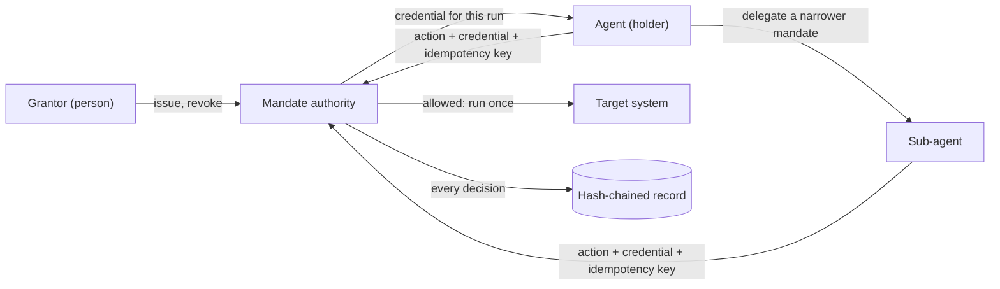

# Agent Mandates

**Agents act under a mandate, never under your identity.**

Version 0.1 (draft for comment), November 2026. Hammed Ajibade.

Agent Mandates is a framework for the authority of AI agents that take actions: who granted it, what it covers, how it ends, and how anyone can prove what happened. It comes with a small [reference implementation](reference/) whose tests demonstrate each control.

---

## The problem

AI agents have moved from writing text to taking actions: deploying code, submitting forms, moving money, editing data. Most of them do it with access that was built for people. Four things go wrong.

1. **Borrowed identity.** The agent logs in as you, holds your tokens, and can do anything you can do. The only limits are instructions in a prompt.
2. **Broad, long-lived access.** The token or service account it uses covers far more than the job, and keeps working long after the job ends.
3. **No clean revocation.** Stopping the agent means rotating a credential that people and other pipelines also depend on, or asking the agent to stop and trusting that it does.
4. **No trustworthy record.** Logs, if they exist, show your name. They can be edited by whoever runs the system, and they do not say who approved what.

When the agent and the person are the same identity:

- you cannot tell their actions apart afterwards,
- you cannot narrow what the agent may do without narrowing yourself,
- you cannot stop the agent without stopping yourself,
- two runs of the same agent look like one actor,
- and nobody can say who approved a given action.

None of this is new. Organisations have let strangers act on someone else's behalf, safely, for a long time. Banks do it every day.

## The idea, borrowed on purpose

A direct debit mandate lets a company take money from your account without ever holding your bank login.

| Direct debit mandate | Agent mandate |
|---|---|
| Names one payee and a purpose | Names one agent and one job |
| Limits amount and schedule | Limits actions, resources, volume, spend and time |
| You cancel it at your bank, not by asking the payee | Revocation is held by the grantor and enforced outside the agent |
| Wrong collections are refunded under a guarantee | Irreversible actions need a second key or a way back |
| Every collection references the mandate you signed | Every action references the mandate it ran under and the person who granted it |
| The same collection is not taken twice | The same instruction has its effect only once |

An agent mandate is that structure, applied to software that acts.

## Security model

A mandate is a grant of authority from an accountable person (the **grantor**) to a specific agent run (the **holder**). The model has five properties.

- **Scoped.** A mandate names the actions it allows and the resources they may touch. Anything not named is refused.
- **Time-limited.** Every mandate expires, by default soon. Standing access is not a mandate.
- **Individually revocable.** The grantor can revoke one mandate, and every mandate delegated from it, without touching any other agent or person.
- **Never the human's own credentials.** The agent presents a credential issued for this mandate. It never holds the grantor's password, session or token.
- **Recorded.** Every grant, allowed action, refusal and revocation is written to an append-only, hash-chained record that names the holder, the mandate and the grantor.

Enforcement sits at a **mandate authority** outside the agent. The agent asks; the authority decides at the moment of execution, not when the work was planned or queued.



On every action the authority checks, in order: the credential maps to a known mandate; neither the mandate nor any ancestor in its delegation chain is revoked or expired; the action and resource are in scope; and the idempotency key has not already been used. Only then does the effect run.

### Threats and controls

| Threat | What it looks like | Control | Where in the reference |
|---|---|---|---|
| Borrowed identity | The agent acts with a person's token; its actions are indistinguishable from theirs | Holder identity per run, distinct from the grantor; credential issued per mandate | `issue` rejects holder equal to grantor |
| Excessive scope | An agent asked to audit something decides to change it | Scope is action plus resource; unnamed actions are refused before the effect runs | `execute` refuses `action_out_of_scope`, `resource_out_of_scope` |
| Standing access | A token issued for one job still works months later | Mandatory expiry and a maximum lifetime | `issue` validation, `maxLifetimeMs` |
| Revocation that depends on the agent | A job marked paused keeps running, because it was trusted to read its own flag | Revocation stored and checked by the authority, outside the agent | `revoke`; next call refused |
| Cached or self-contained credentials | A revoked token keeps working until it expires | Opaque credential looked up on every call | credential digest lookup in `execute` |
| Delegation escalation and orphaned sub-agents | A sub-agent receives more than its parent had, or keeps working after the parent is stopped | Delegation can only narrow scope and lifetime; every check walks the chain | `delegate`, chain check |
| Queued and in-flight work | Actions approved before revocation still run after it | Check at execution time; cancellation signal to running effects | `AbortSignal` per effect |
| Duplicate effects | A retry after a timeout repeats a payment, submission or deploy | Idempotency key scoped to the grantor | `execute` returns `replayed` |
| Repudiation and edited evidence | Nobody can say who approved an action, or the log was changed afterwards | Hash-chained record naming holder, mandate and grantor; anchored head | `AuditRecord`, `verifyRecord` |
| Goal hijack (prompt injection) | Injected content redirects the agent | Not prevented. The mandate bounds what a hijacked agent can do | scope and expiry limit the blast radius |

## What a mandate contains

A mandate is a record, issued by a person or an accountable system, that an agent presents when it acts. At minimum it states:

1. **Grantor**: the person who is accountable for what the agent does.
2. **Holder**: the specific agent and the specific run it was issued to.
3. **Purpose**: the job, in plain words.
4. **Scope**: the actions allowed, on which resources.
5. **Limits**: counts, amounts, rates and spend.
6. **Expiry**: when it stops working, by default soon.
7. **Approval points**: which actions need a second key before they happen.
8. **Revocation channel**: where the grantor cancels it, outside the agent.

## Action classes

Not every action carries the same risk. A mandate grants each class separately.

| Class | Example | Default |
|---|---|---|
| **Read** | Query logs, list files, inspect a system | Allowed within scope |
| **Recommend** | Draft a change, propose a fix, prepare a form | Allowed; nothing leaves the agent |
| **Execute** | Apply a change, submit a form, send a message | Only when named in the mandate |
| **Irreversible** | Delete data, deploy to production, move money, publish | Second key, or a tested way back |

## The six principles

### 1. Mandate, not identity

An agent never acts as a person. It acts under its own identity, holding a mandate from a person.

- An agent's credentials MUST be distinct from any human's credentials.
- Each run SHOULD receive its own holder identity, so concurrent runs are distinguishable.
- Systems that receive an agent's action MUST be able to tell it came from an agent, and which one.

*Prevents:* two runs of one job submitting the same application twice under one shared identity; an agent posting under a brand it was never meant to speak for.

### 2. Bounded by default

A mandate states its purpose, scope, limits and expiry. Anything not granted is refused.

- A mandate MUST have an expiry. Standing access is not a mandate.
- Scope MUST be expressed as action class plus resource, not as "everything this user can do".
- Limits SHOULD cover volume and spend, so one job cannot exhaust a budget shared with people.

*Prevents:* an agent asked to audit something deciding to change it; scheduled jobs consuming a shared quota until the people who share it are locked out.

### 3. The grantor holds the off switch

Revocation belongs to the grantor and is enforced outside the agent.

- Revoking a mandate MUST take effect without the agent's cooperation.
- A paused or revoked agent MUST NOT be able to act, even if its own configuration says otherwise.
- Revocation SHOULD take effect within seconds and be observable: the grantor can confirm it worked.

*Prevents:* a job marked as paused that keeps running, because the pause was a flag the job itself was trusted to read.

### 4. Irreversible needs a second key

An action that cannot be undone needs either a second approval or a tested way back before it runs.

- The mandate MUST name which actions are irreversible.
- Irreversible actions MUST require an approval by someone other than the agent, or a recovery path that has been verified to exist at the time of the action.
- Deleting the recovery path (backups, rollback images, previous versions) is itself irreversible.

*Prevents:* an automated deploy that wipes a production database's accounts; a rollback that fails because the image it needed had already been pruned.

### 5. Every action has an owner

Every action traces to the mandate it ran under and the person who granted it.

- Each action record MUST reference the holder, the mandate, and the grantor.
- Approvals MUST be recorded with who approved, what they saw, and when.
- Records SHOULD be append-only and tamper-evident.

*Answers:* "Who approved that?", with evidence instead of a guess.

### 6. Once means once

The same instruction has its effect only once, no matter how many times it is retried.

- Execute and irreversible actions MUST carry an idempotency key derived from the mandate and the intended effect.
- A retry, a restart, or a second run of the same job MUST NOT repeat an effect that already happened.

*Prevents:* the duplicate submission, payment or post that appears when a job is retried after a timeout it actually survived.

## Maturity levels

| Level | Name | What is true |
|---|---|---|
| **0** | Borrowed identity | Agents act as a person. Limits live in prompts. |
| **1** | Separate credentials | Agents have their own credentials with narrowed scope. No expiry or per-run identity. |
| **2** | Mandated | Per-run mandates with purpose, scope, limits and expiry. Revocation works from outside the agent. |
| **3** | Accountable | Level 2, plus second keys on irreversible actions, idempotent execution, and a tamper-evident record linking every action to a mandate and a grantor. |

## Audit checklist

For any agent that acts:

1. Can you tell this agent's actions apart from the person's, and from its other runs?
2. Does its access expire on its own?
3. Can you list exactly what it is allowed to do, by action class and resource?
4. If you revoke it now, does it stop without its cooperation, and can you prove it stopped?
5. Which of its possible actions are irreversible, and what stands in front of each one?
6. For any action it took last week, can you name the mandate and the person who granted it?
7. If its last run is retried, what happens twice?

## Mapping to established work

Agent Mandates is an authority view. The documents below describe threats, risks and obligations; the mandate model is one way to meet the parts of them that concern who may act, for how long, and with what evidence. These mappings are the author's own reading. None of these bodies has reviewed or endorsed this framework.

### OWASP Top 10 for Agentic Applications (2026)

The [OWASP Top 10 for Agentic Applications for 2026](https://genai.owasp.org/resource/owasp-top-10-for-agentic-applications-for-2026/), published by the OWASP GenAI Security Project in December 2025.

| Risk | How mandates address it | Coverage |
|---|---|---|
| ASI03 Identity and Privilege Abuse | Own identity per run, never the grantor's credentials (principle 1); narrowing delegation with chain-wide revocation (principle 3); expiry (principle 2) | Primary |
| ASI02 Tool Misuse and Exploitation | Scope as action plus resource, checked at execution; action classes; second key for irreversible actions (principles 2 and 4) | Primary |
| ASI10 Rogue Agents | Revocation enforced outside the agent, without its cooperation; tamper-evident record of what it did (principles 3 and 5) | Partial: limits and stops, does not detect |
| ASI08 Cascading Failures | Revoking a parent stops every delegated sub-agent; idempotency stops retries multiplying effects (principles 3 and 6) | Partial |
| ASI01 Agent Goal Hijack | Does not prevent hijack; bounds what a hijacked agent can do to its mandate | Blast radius only |
| ASI07 Insecure Inter-Agent Communication | Delegation is explicit and narrowing, so a sub-agent's authority is checkable | Partial: does not secure the channel |
| ASI09 Human-Agent Trust Exploitation | Approvers record what they saw (principle 5), and approval binds to that exact action | Partial |

The earlier [OWASP Agentic AI: Threats and Mitigations](https://genai.owasp.org/resource/agentic-ai-threats-and-mitigations/) (OWASP Agentic Security Initiative, February 2025) gives the underlying threat model and mitigation playbooks. Its threats concerning privilege, identity and impersonation are the ones this framework targets most directly.

### OWASP Top 10 for LLM Applications (2025)

[LLM06:2025 Excessive Agency](https://genai.owasp.org/llmrisk/llm062025-excessive-agency/) recommends minimising extension permissions, requiring user approval for high-impact actions, and implementing authorisation in downstream systems "rather than relying on an LLM to decide if an action is allowed or not", which it calls complete mediation. Mandates make those concrete: scope is the minimised permission set, the second key is the approval, and the mandate authority is the downstream authorisation. LLM06 also recommends executing extensions in the user's context with minimum privileges. Mandates keep the user's authority as the source (the grantor) while refusing to let the agent hold the user's credentials.

### NIST AI Risk Management Framework

The [NIST AI RMF 1.0](https://www.nist.gov/itl/ai-risk-management-framework) (NIST AI 100-1, January 2023) organises AI risk work into four functions.

| Function | Mandate practice |
|---|---|
| **Govern** | A named grantor is accountable for every agent action. Mandate policy (maximum lifetime, which classes need a second key) is set by the organisation, not by the agent. |
| **Map** | Each agent's possible actions are listed by class and resource, and irreversible actions are named before they can run (audit checks 3 and 5). |
| **Measure** | Revocation drills measure time to stop and prove it with a recorded refusal. Record verification and refusal rates are measurable. |
| **Manage** | Expiry, revocation, second keys and idempotency are the treatments; the record supports incident review. |

NIST's National Cybersecurity Center of Excellence has also published a concept paper, [Accelerating the Adoption of Software and Artificial Intelligence Agent Identity and Authorization](https://csrc.nist.gov/pubs/other/2026/02/05/accelerating-the-adoption-of-software-and-ai-agent/ipd) (February 2026), which asks how to identify, authorise and audit AI agents and support non-repudiation of their actions. Those are the questions this framework answers at the level of principles.

### UK Information Commissioner's Office

The ICO's [Tech futures: Agentic AI](https://ico.org.uk/about-the-ico/research-reports-impact-and-evaluation/research-and-reports/technology-and-innovation/tech-horizons-and-ico-tech-futures/ico-tech-futures-agentic-ai/) report (January 2026) is not guidance, but it sets out the regulator's early view. It states that "organisations remain responsible for data protection compliance of the agentic AI they develop, deploy or integrate in their systems and processes", and warns about purposes "set too broadly to allow for open-ended tasks", systems connected to "databases not needed for their tasks", and systems with "no measures in place to secure access, monitor or stop activity".

On 8 October 2026 the ICO opened an [agentic AI call for evidence](https://ico.org.uk/about-the-ico/ico-and-stakeholder-consultations/2026/10/agentic-ai-call-for-evidence/), open until 20 November 2026, with sections on data security, transparency, accountability, automated decision-making, fairness and purpose limitation, and lawfulness of processing. Announcing it, the ICO said that ["the fact AI agents act with autonomy is not an excuse for poor compliance"](https://ico.org.uk/about-the-ico/media-centre/news-and-blogs/2026/10/ico-secures-changes-from-leading-ai-developers-as-scrutiny-extends-to-ai-agents/).

| ICO concern | Mandate practice |
|---|---|
| Accountability stays with the organisation | Every action names a grantor; the record lets the organisation show who authorised what |
| Purposes set too broadly | A mandate states one purpose and an explicit scope; open-ended "do anything the user can" grants are not mandates |
| Access to data not needed for the task | Resource scope; anything not named is refused |
| Means to secure access, monitor or stop activity | Credentials per mandate, a tamper-evident record, and revocation from outside the agent |

A mandate's grantor is an operational accountability role. It does not decide who is the controller or processor under UK GDPR, and following this framework is not a claim of legal compliance.

### Protocols and prior art

- **Least privilege** and **capability-based security** ([Dennis and Van Horn, 1966](https://doi.org/10.1145/365230.365252)): authority travels with an unforgeable grant, not with an identity.
- **The confused deputy** ([Hardy, 1988](https://doi.org/10.1145/54289.871709)): a program misusing authority it holds for someone else.
- **OAuth 2.0 Token Exchange** ([RFC 8693](https://www.rfc-editor.org/rfc/rfc8693)): delegation and actor claims, a building block for issuing mandates.
- **OAuth 2.0 Token Introspection** ([RFC 7662](https://www.rfc-editor.org/rfc/rfc7662)) and **Token Revocation** ([RFC 7009](https://www.rfc-editor.org/rfc/rfc7009)): a resource server asking the authority, on each request, whether a token is still active is what makes revocation immediate.
- **OpenID Continuous Access Evaluation Profile 1.0** ([CAEP](https://openid.net/specs/openid-caep-1_0-final.html)): pushes events such as session revocation to systems that would otherwise keep trusting a cached decision.
- **The Idempotency-Key HTTP header** ([IETF Internet-Draft](https://datatracker.ietf.org/doc/draft-ietf-httpapi-idempotency-key-header/)): a standard way to carry principle 6 over HTTP. It is a draft, not yet an RFC.
- **Tamper-evident logging** ([Crosby and Wallach, USENIX Security 2009](https://www.usenix.org/legacy/events/sec09/tech/full_papers/crosby.pdf)): hash-chained and tree-based logs, and why the verifier must hold a commitment the writer cannot change.
- **Agent Payments Protocol (AP2)** ([announcement](https://cloud.google.com/blog/products/ai-machine-learning/announcing-agents-to-payments-ap2-protocol)): uses signed mandates for agent payments. Agent Mandates applies the same model to every kind of action.
- **EU AI Act, Article 14** ([Regulation (EU) 2024/1689](https://eur-lex.europa.eu/eli/reg/2024/1689/oj)): human oversight of high-risk AI systems, including the ability to intervene and stop. Second keys and external revocation are practical forms of that oversight for agents.

## Running example

[`reference/`](reference/) is a small TypeScript implementation with no runtime dependencies and no external services. It issues mandates, checks every action at execution time, revokes immediately (including every delegated sub-agent), enforces expiry, keeps a hash-chained record with a tamper check, and executes a retried action once.

```sh
cd reference
npm test          # 55 tests, injected clock, Node.js 22.18 or later
npm run drill     # a scripted revocation drill that prints the evidence
```

The tests are the specification in executable form: a revoked mandate is refused on the very next call with no clock movement; an action is allowed at one millisecond before expiry and refused at the expiry instant; queued work approved before revocation is refused when it runs; editing, deleting or reordering any record entry is detected. See the [reference README](reference/README.md) for design decisions and limits.

The write-up [Revoking an AI agent: what actually has to happen](docs/revoking-an-ai-agent.md) uses the reference as its worked example.

## What this does not solve

- **It does not make an agent's reasoning safe.** Prompt injection, goal hijack, poisoned memory and wrong answers are out of scope. A mandate limits what a misled agent can do; it does not stop it being misled.
- **It is not a protocol or a product.** There is no wire format. Mandates can be built from existing pieces (OAuth token exchange, introspection, workload identity, policy engines), and the framework says what those pieces must achieve, not which to use.
- **It cannot undo an effect that has started.** Revocation can refuse the next action and signal running work, but an effect already in progress at a third party may complete. Principle 4 exists for that reason.
- **Revocation is only as fast as the slowest enforcement point.** A downstream system that caches authorisation or accepts self-contained tokens will keep honouring them until they expire.
- **A tamper-evident record is not a tamper-proof one.** A hash chain shows that a record was changed; it cannot stop the operator of the system from changing it. That needs a head hash anchored somewhere the writer does not control.
- **It does not settle legal roles.** Grantor accountability is operational. It does not determine controller or processor status, liability, or compliance with any regulation.
- **It is unproven at scale.** This is a draft for comment. The reference implementation is a single process with in-memory state, built to demonstrate the controls, not to run production traffic.

## Talks

Slides from talks that introduce or apply the framework are in [talks](talks/).

## Status and feedback

This is version 0.1. The principles are intended to stay stable; the requirements and levels will change with feedback from people building and auditing agent systems. Version 0.1 adds the security model, the mappings, the reference implementation and the revocation write-up. The principles, levels and checklist are unchanged from version 0.

Feedback, objections and real-world examples are welcome as [issues](https://github.com/ajibadedapo/agent-mandates/issues).

## Citing

> Ajibade, H. (2026). *Agent Mandates: agents act under a mandate, never under your identity* (Version 0.1). https://github.com/ajibadedapo/agent-mandates

## Licence

[CC BY 4.0](LICENSE). Use, adapt and build on it, including commercially, with attribution.
